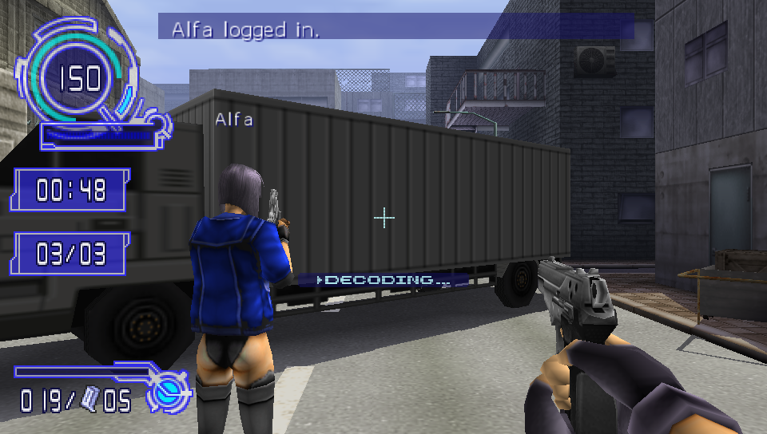
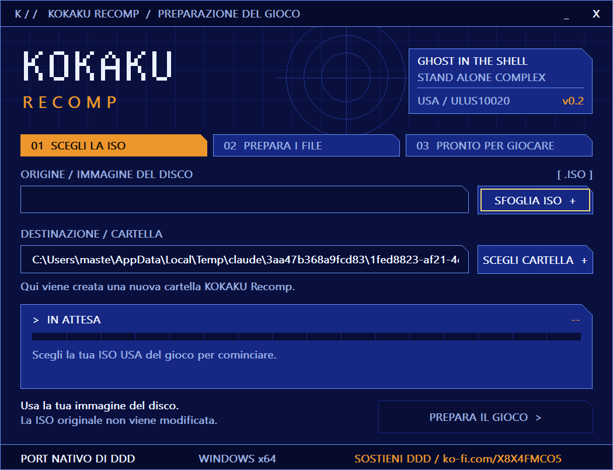
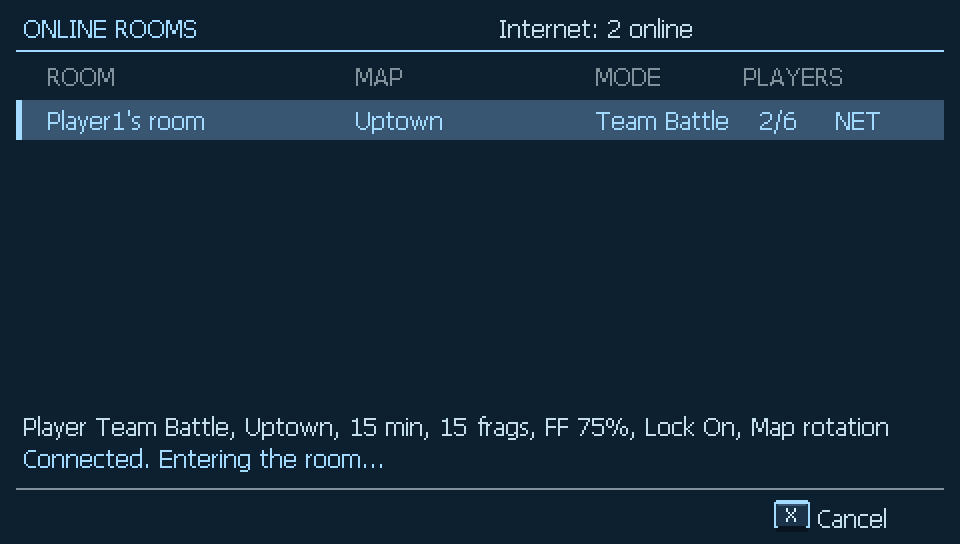
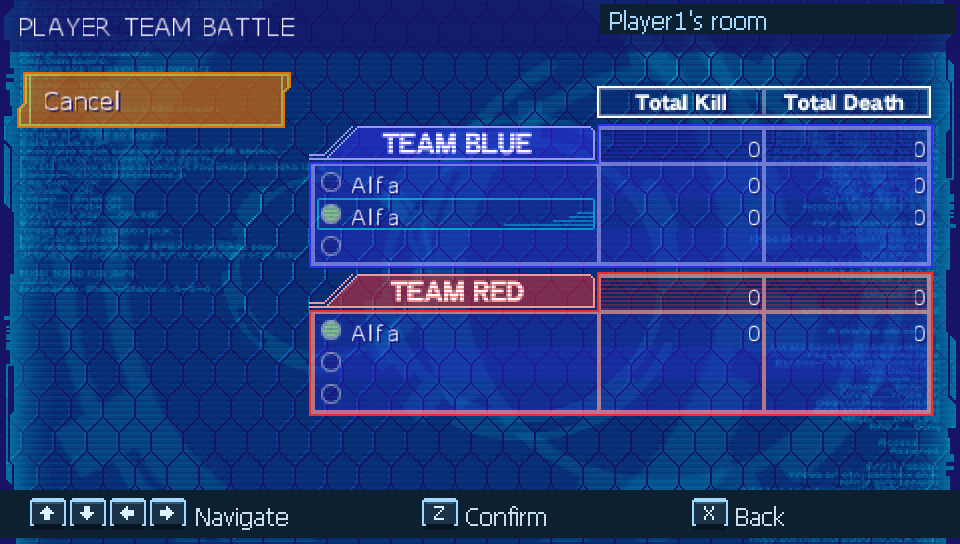

# KOKAKU Recomp

A native Windows port of **Ghost in the Shell: Stand Alone Complex** (PSP, USA, ULUS10020), built by static recompilation. No emulator: the game's code runs as a Windows x64 program with a DirectX 12 renderer, keyboard and mouse controls, 60 FPS, and online multiplayer with a worldwide room list.

Port by **DDD**. Support the project: <https://ko-fi.com/X8X4FMCO5>

> You need your own copy of the game. This repository and the setup contain **no game data**: the setup reads the ISO you provide and prepares the game from it.

## Download and install

1. Get **KOKAKU Recomp Setup.exe** from the [Releases](../../releases) page.
2. Open it and select your *Ghost in the Shell: Stand Alone Complex* **USA (ULUS10020)** `.iso`.
3. Choose a folder. The setup creates a `KOKAKU Recomp` folder there.
4. Press **Prepare game**, then open the folder and run **KOKAKU Recomp.exe**.

The setup works offline and needs no administrator rights. It checks the disc ID, file sizes and SHA-256 hashes, so other regions, modified or damaged images are rejected. Your ISO is opened read-only and is never changed. The interface is in Italian on an Italian Windows and in English everywhere else.

**Requirements:** Windows 10 or 11, 64-bit, and a DirectX 12 graphics card.

## What the port adds

- **60 FPS**, with the original 30 FPS still available.
- **Keyboard and mouse**, rebindable from the game's own OPTION screen, plus widescreen and resolution settings.
- **Online multiplayer** for up to 6 players, with a room list (see below).
- Native saves, kept in the game folder.

## Online multiplayer

The original game only found players on the same local wireless network. The port replaces that blind search with a list of rooms.

- **Host:** Multi Play → **Create**, set the rules, wait in the room. A line at the top right says whether the room is listed online.
- **Join:** Multi Play → **Join** shows the rooms open on the internet and on your local network. Pick one and confirm.

How it works, and what to expect:

- Players connect **directly to each other**. A small free service only keeps the room list and introduces the players; no game traffic passes through it.
- Because there is no relay server, some pairs of routers cannot connect (mobile networks and strict NATs in particular). If a room cannot be reached, let the player with the better connection host, or forward **UDP port 3658** on the host's router.
- Everyone needs the **same version** of the port. PSP consoles and PPSSPP cannot join.
- The public list shows room names, rules and player counts, never addresses. Players in the same room can see each other's IP address, as in any peer-to-peer game.
- When a connection fails, close the game and look at the lines starting with `online:` in `KokakuNative.log`, next to the executable.

## Status

This is a work in progress.

- The intro, the briefing and the start of the first mission work. **The full campaign has not been verified.**
- Online multiplayer is new. It has been tested with two and three copies of the game on one PC, through the public room list, with simulated routers and simulated internet delay. **Play between two different home connections has not been tested yet**: reports are welcome.
- More than three players, and damage and kills between remote players, have not been verified.

## Building from source

The repository holds the code written for the port. It does **not** hold the recompiled game code or any game data, so a build needs your own ISO and the recompilation step first.

| Folder | Content |
| --- | --- |
| `tools/PSPRecomp/` | The static recompiler and runtime (MIT), with the game profile in `profiles/kokaku/host/` |
| `tools/patch_kokaku_*.py` | Hooks reapplied to the generated code after recompilation |
| `launcher/` | The setup program |
| `lobby/` | The room list service (Cloudflare Workers), see `lobby/README.md` |

Detailed notes, in Italian, are in `COME_AVVIARE.md`.

The modloader is not part of this repository for now. The build files of the game profile still refer to it, so building from these sources alone needs that part removed or stubbed.

## Credits

- **DDD** (Daniele Trippodo): the port, the setup, the online multiplayer.
- **[jessicanataliagta](https://github.com/jessicanataliagta)**: [PSPRecomp](https://github.com/jessicanataliagta/PSPRecomp), the static recompiler and runtime this port is built on. A modified copy is in `tools/PSPRecomp/`, under its own MIT license.

The code written for the port is under the MIT license (see `LICENSE`).

## Legal

*Ghost in the Shell: Stand Alone Complex* and all related names and assets belong to their respective owners. This is an unofficial fan project, not affiliated with or endorsed by them. It does not include or distribute the game: you must own it.

Third-party components and their licenses (PSPRecomp, FFmpeg, DirectX Shader Compiler, Departure Mono) are listed in the `licenses` folder of the prepared game.
